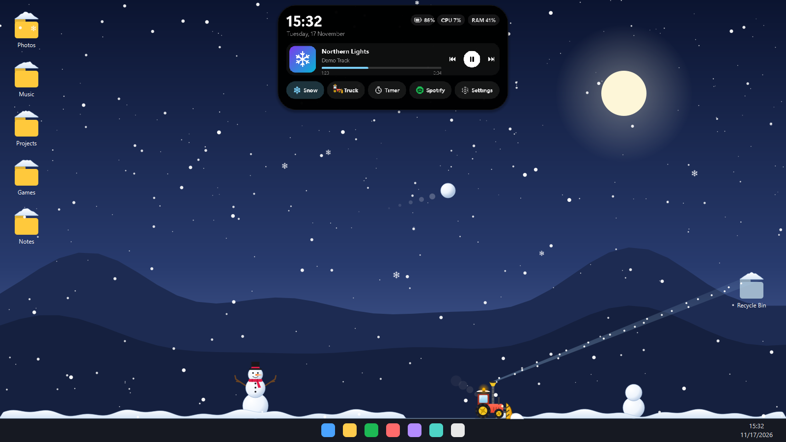

# ❄️ Snow Island

**Make your Windows desktop snow.** A floating, phone-style "island" bar for Windows 11 (and 10)
with a cozy **winter mode**: snow falls across your screen, piles up on your desktop icons and
taskbar, and you can throw snowballs, build snowmen, and call a little snow truck to clean it all up.

Everything runs **locally on your PC**. No account, no server, no tracking.

  <a href="https://github.com/404existenceerror-dot/snow-island/releases/latest"><b>⬇️ Download SnowIsland.exe</b></a> ·
  <a href="https://github.com/404existenceerror-dot/snow-island/issues/new?template=bug_report.yml">🐞 Report a bug</a> ·
  <a href="https://github.com/404existenceerror-dot/snow-island/issues/new?template=feature_request.yml">💡 Suggest a feature</a>

*If you like it, a ⭐ on GitHub helps other people find it!*

---

## Features

### The island
- Sits at the top of your screen and **grows when you hover it**
- **Clock and date**, **battery**, **CPU** and **RAM**
- **Music player** for Spotify (and any other app that shows up in Windows' media controls):
  album art, song title, progress bar, play/pause/next/previous
- **Pops out** for a moment when the song changes
- **Timer** button (each click adds 5 minutes, right-click to cancel)
- **Scroll** on the island to change the volume
- **Drag it anywhere**, or pick a spot: top/bottom, left/center/right
- Customize colors, size, width, opacity, corner roundness, 12/24-hour clock and which widgets show
- Hides automatically in fullscreen games/videos and steps aside for screen-recorder toolbars

### Winter mode
- Snow falls over the screen and **piles up on desktop icons and along the taskbar**
- Piles hide behind open windows and fade back in when you show the desktop
- **Snowballs**: hold the mouse on the desktop to roll one, drag and let go to throw it
- **Snowmen**: hold on the taskbar snow and drag sideways to roll a big ball, let go. Roll two
  more, lift each one up and drop it on top. The finished snowman gets a hat, scarf and carrot nose
- **Snow truck**: drives along the taskbar, plows the snow and vacuums it off your icons
  (it knocks snowmen over too). It can also come by itself every few minutes
- **Brush**: flick the mouse quickly over an icon to brush its snow off
- Adjustable amount of snow, flake size, fall speed, wind, pile height and more

---

## Download and run

### Option 1: the ready-made app (easiest)
1. Go to the **Releases** page of this repository and download `SnowIsland.exe`.
2. Double-click it. A snowflake icon appears in the system tray (bottom right).

Windows SmartScreen may warn about an "unrecognized app" because the file isn't code-signed.
Click **More info → Run anyway**.

### Option 2: run from the source code
You need **Python 3.10 or newer** from [python.org](https://www.python.org/downloads/)
(tick **"Add python.exe to PATH"** while installing).

1. Click **Code → Download ZIP** on this page and unzip it (or `git clone` it).
2. Double-click **`start.bat`**.

The first start downloads the libraries it needs (about 100 MB, one time only).
After that it starts in a couple of seconds and works offline.

---

## How to use it

| What | How |
| --- | --- |
| Open the island | Hover over it (or click it) |
| Settings | Click **Settings** on the island, or right-click the tray snowflake |
| Move the island | Drag it. Drop near the top center to snap it back |
| Lock / reset position | Right-click the island |
| Change volume | Scroll on the island |
| Throw a snowball | Hold the mouse on the desktop, drag, let go |
| Build a snowman | Hold on the taskbar snow, drag sideways, let go. Repeat twice and drop the balls on top |
| Clean up the snow | Click **Truck** on the island |
| Melt snowmen | Right-click the island or tray icon → **Melt all snowmen** |
| Turn winter mode on/off | Click **Snow** on the island |
| Quit | Right-click the tray snowflake → **Quit** |

### Spotify
Just use the normal Spotify desktop app. Snow Island reads what's playing from Windows' built-in
media controls, so there's nothing to log into. Other players (browsers, YouTube, VLC, etc.) work
too; Spotify is preferred when several are playing.

### Start with Windows
Settings → **Widgets** → **Start with Windows**.

---

## Privacy
- Snow Island makes **no internet connections**. (Running from source downloads the Python
  libraries once during setup; the `.exe` doesn't need even that.)
- Settings are saved in `%APPDATA%\SnowIsland\settings.json`. Nothing else is stored.
- To read where your desktop icons are, it asks Windows Explorer for the icon positions.
  It never reads or changes your files.

## Uninstall
1. Quit it from the tray icon (and turn off **Start with Windows** first if you enabled it).
2. Delete the folder (or the `.exe`) and `%APPDATA%\SnowIsland`.

---

## Troubleshooting
- **No snow on the icons**: make sure desktop icons are shown (right-click desktop → View →
  Show desktop icons) and that "Snow piles up on desktop icons" is on in Settings → Winter.
- **The music player says "Nothing playing"**: start playing in Spotify; it can take a second
  to show up.
- **It uses too much CPU**: lower *Animation smoothness* or *Amount of snow* in Settings → Winter.
- **Multiple monitors**: the island and snow appear on your main display.
- **Reporting a bug**: run `SnowIsland.exe --diagnose` (or `start.bat`'s Python with
  `snow_island.py --diagnose`). It opens a short report (`%APPDATA%\SnowIsland\diagnose.txt`)
  with your Windows version and what the app detected. Song titles are not included.
  Attach it to a GitHub issue.

---

## Feedback and bug reports
Found a bug or have an idea? Please tell me!

- **From the app:** right-click the tray snowflake (or the island) → **Report a bug…** or
  **Suggest a feature…**. Your browser opens a GitHub form with the app and Windows version
  already filled in. Nothing is sent until you press *Submit*.
- **On GitHub:** open the [Issues](https://github.com/404existenceerror-dot/snow-island/issues/new/choose) tab and pick a form.

A screenshot or short screen recording (Win + Shift + R) makes bugs much faster to fix.

## Contributing
Pull requests are welcome! See [CONTRIBUTING.md](CONTRIBUTING.md).

## Build the .exe yourself
Double-click **`build_exe.bat`**. It creates `dist\SnowIsland.exe`, which you can upload to a
GitHub Release.

## Project layout
| File | What it does |
| --- | --- |
| `snow_island.py` | Starts the app, tray icon, ties everything together |
| `island.py` | The island bar: drawing, animation, buttons, dragging |
| `winter.py` | Snow, piles, snowballs, snowmen and the snow truck |
| `media.py` | Now-playing info from Windows media controls |
| `art.py` | Hand-drawn graphics (truck, snowman, icons) |
| `winapi.py` | Small Windows helpers (desktop icons, battery, CPU, windows) |
| `settings.py` / `settings_dialog.py` | Settings storage and the settings window |

## License
[MIT](LICENSE). Free to use, change and share.

Spotify is a trademark of Spotify AB. This project is not affiliated with Spotify or Microsoft.
